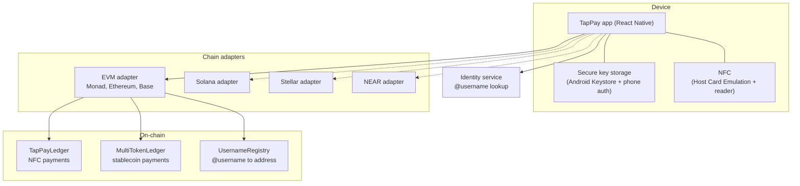

<p align="center">
  
</p>

<h1 align="center">TapPay</h1>

<p align="center">
  <strong>The contactless wallet for multi-chain payments.<br/>Tap two phones, or send to an <code>@username</code>. Settled on-chain in about a second.</strong>
</p>

<p align="center">
  <a href="https://x.com/tapxpay">
    
  </a>
  
  <a href="https://x.com/tapxpay">
    
  </a>
</p>

<p align="center">
  
  
  
  
  
</p>

---

## Contents

- [What is TapPay](#what-is-tappay)
- [Features](#features)
- [Supported networks](#supported-networks)
- [How it works](#how-it-works)
- [Security](#security)
- [Architecture](#architecture)
- [Contracts](#contracts)
- [Tech stack](#tech-stack)
- [Getting started](#getting-started)
- [Project structure](#project-structure)
- [Testing NFC](#testing-nfc)
- [Roadmap](#roadmap)
- [Documentation](#documentation)
- [Team](#team)

---

## What is TapPay

TapPay is a non-custodial mobile wallet that makes on-chain payments as simple as a contactless card. Hold two phones together and the payment is sent and settled. Or type an `@username` instead of a 42-character address.

It is built to be multi-chain from the start. One wallet, one `@username`, and a common payment flow across the networks people actually use. TapPay is live on **Monad** and **Ethereum**, and is expanding to **Base, Solana, Stellar and NEAR**.

There is no custody, no account to create and no server holding your keys. Your wallet lives on your phone.

---

## Features

| | |
|:--|:--|
| **Tap to Pay** | Hold two phones together. The receiver's address is read over NFC, the payment is signed on your device and settles on-chain. No typing, no copy-paste. |
| **Username Pay** | Send to `@username`. Pick a token, enter an amount on the keypad, confirm. |
| **Stablecoins first** | Send AUSD, USDC and USDT as easily as the native token. |
| **Phone-secured keys** | Keys are stored in secure hardware and every payment needs your fingerprint, face or screen lock. |
| **Recovery phrase** | A standard 12-word BIP-39 phrase backs up your wallet. It is shown once, only after phone authentication. |
| **Clear receipts** | Every payment ends with a receipt: who, how much, which network, and an explorer link. |
| **Sound and haptics** | A short chime and haptic confirm a completed payment. Both can be turned off in Settings. |

---

## Supported networks

| Network | Status | Notes |
|:--------|:-------|:------|
| **Monad** | Live | Primary network. About 1 second finality. |
| **Ethereum** | Live | EVM payments and stablecoins. |
| **Base** | Coming soon | EVM L2, same contracts and flow. |
| **Solana** | In development | Native program and SPL token support. |
| **Stellar** | In development | Stellar assets and Soroban. |
| **NEAR** | In development | Account-based `@username` mapping. |

Networks are added through a chain adapter layer, so the wallet, NFC flow and `@username` experience stay identical on every chain.

---

## How it works

### Tap to Pay

```
Sender opens Send  ->  enters amount  ->  "Hold near reader"
                                              |
                  NFC tap  <------------------+
                    |
                    v
   Receiver's address is read over NFC (Host Card Emulation)
                    |
                    v
   Sender confirms, then signs on-device (secure hardware + phone auth)
                    |
                    v
   Payment is broadcast and settles on-chain
                    |
                    v
   Both phones show a Sent / Received receipt
```

### Username Pay

```
Pay  ->  search @username  ->  choose token  ->  enter amount  ->  confirm
                                                                     |
                                                                     v
                                                 Signed on-device, settled on-chain, receipt shown
```

---

## Security

- **Non-custodial.** TapPay never sees or stores your private key.
- **Secure hardware.** The key is held in the Android Keystore and unlocked by your fingerprint, face or screen lock for each payment.
- **One wallet per device.** Creating or restoring a wallet is refused while one exists.
- **Recovery phrase protection.** The phrase is revealed only after phone authentication, cannot be copied, hides itself after 30 seconds and is cleared when the app goes to the background.
- **Confirm before you pay.** The amount, recipient and fee are shown before anything is signed.
- **Pass-through contracts.** The payment contracts forward funds atomically and hold nothing. They use replay protection, reentrancy guards and pausable ownership.

Found a vulnerability? Please report it privately to the maintainers instead of opening a public issue.

---

## Architecture



Solid lines are live. Dotted lines are in development.

---

## Contracts

The EVM contracts are deployed on Monad (chain ID `143`).

| Contract | Address | Explorer |
|:---------|:--------|:---------|
| **UsernameRegistry** | `0x458DD61Db411ec1feFC069B7B094a983E3a3E265` | [View ↗](https://monadscan.com/address/0x458DD61Db411ec1feFC069B7B094a983E3a3E265) |
| **TapPayLedger** | `0x03907aE845E016f5F1605BAE4e6392C3491e03f1` | [View ↗](https://monadscan.com/address/0x03907aE845E016f5F1605BAE4e6392C3491e03f1) |
| **MultiTokenLedger** | `0x15319f757FC0e600E681bC0bffD69541916F8860` | [View ↗](https://monadscan.com/address/0x15319f757FC0e600E681bC0bffD69541916F8860) |

**Supported tokens (Monad)**

| Token | Address |
|:------|:--------|
| AUSD | [`0x00000000eFE302BEAA2b3e6e1b18d08D69a9012a`](https://monadscan.com/address/0x00000000eFE302BEAA2b3e6e1b18d08D69a9012a) |
| USDC | [`0x754704Bc059F8C67012fEd69BC8A327a5aafb603`](https://monadscan.com/address/0x754704Bc059F8C67012fEd69BC8A327a5aafb603) |
| USDT | [`0xe7cd86e13AC4309349F30B3435a9d337750fC82D`](https://monadscan.com/address/0xe7cd86e13AC4309349F30B3435a9d337750fC82D) |

<details>
<summary><strong>TapPayLedger</strong> — NFC payment rail</summary>

- `payWithLog(to, sessionIdHash)` forwards `msg.value` to the recipient atomically and emits `PaymentLogged`
- Reentrancy guard and checks-effects-interactions
- Session-based replay protection scoped to each payer
- Pausable, `Ownable2Step`
- Pass-through only, zero custody

</details>

<details>
<summary><strong>MultiTokenLedger</strong> — token payment rail</summary>

- Native token via `payWithLog`, ERC-20 via `payERC20WithLog`
- Safe handling of USDT-style and fee-on-transfer tokens
- `PaymentLogged` includes the token address

</details>

<details>
<summary><strong>UsernameRegistry</strong> — identity mapping</summary>

- Maps `@username` to a wallet address, with reverse lookup for receipts
- Ownership is proven with a signed message

</details>

---

## Tech stack

| Layer | Technology |
|:------|:-----------|
| **Mobile** | React Native 0.87 (bare workflow), TypeScript |
| **NFC** | `react-native-hce` (Host Card Emulation), `react-native-nfc-manager` |
| **Wallet** | `ethers` v6, BIP-39 recovery phrase |
| **Key security** | Android Keystore via `react-native-keychain`, phone biometrics / screen lock |
| **UI** | iOS-style design system: grouped lists, glass surfaces, `react-native-svg` |
| **Feedback** | `react-native-sound` for payment sounds, haptics |
| **Smart contracts** | Solidity, Hardhat, OpenZeppelin |
| **Identity** | Supabase (`@username` resolution) |
| **CI** | GitHub Actions: lint, unit tests, contract tests, release build |

---

## Getting started

### Prerequisites

- Node.js 22 or newer
- JDK 17
- Android SDK (API 34, Build-Tools 34)
- Two physical Android phones with NFC (emulators cannot do Host Card Emulation)

```bash
# macOS / Linux
export JAVA_HOME=$(/usr/libexec/java_home -v 17)
export ANDROID_HOME=$HOME/Android/Sdk
```

### Run the app

```bash
git clone https://github.com/anuraggdubey/Tap-Pay.git
cd Tap-Pay
npm install

# Terminal 1: Metro bundler
npm start

# Terminal 2: build and install
npx react-native run-android
```

### Test

```bash
npm test          # app unit tests
npm run lint      # ESLint
```

### Contracts

```bash
cp .env.example .env
# set DEPLOYER_PRIVATE_KEY (funded with the native token for gas)
npx hardhat test
```

Deploying to a live network is a maintainer task. See [CONTRIBUTING.md](./CONTRIBUTING.md).

---

## Project structure

```
TapPay/
├── android/                     # Native Android + HCE service
├── contracts/
│   ├── TapPayLedger.sol         # NFC payment contract
│   ├── UsernameRegistry.sol     # @username to address mapping
│   └── AgoraBounty/
│       └── MultiTokenLedger.sol # Token payment contract
├── src/
│   ├── config/                  # Networks, RPC, contract addresses
│   ├── services/                # Wallet, NFC, payments, registry, tokens
│   ├── screens/                 # Home, Send, Receive, History, Settings...
│   ├── components/              # Glass surfaces, lists, NFC and receipt UI
│   ├── theme/                   # Palettes and tokens
│   └── navigation/              # Stack + floating tab bar
├── web/                         # Marketing website
├── supabase/                    # Identity service functions and migrations
├── scripts/                     # Hardhat scripts
├── test/                        # Contract tests
└── docs/                        # Specs and guides
```

---

## Testing NFC

NFC Host Card Emulation needs **two physical Android phones**.

| Step | Sender | Receiver |
|:-----|:-------|:---------|
| 1 | Open the app, enable NFC | Open the app, enable NFC |
| 2 | Choose **Send > Tap to Pay**, enter an amount | Open **Receive** |
| 3 | Hold the phones back to back (about 4 cm) | |
| 4 | Confirm and sign | |
| 5 | Sent receipt | Received receipt, balance updates in a second or two |

---

## Roadmap

- [x] Tap to Pay and Username Pay on Monad
- [x] Ethereum support
- [x] Stablecoin payments (AUSD, USDC, USDT)
- [x] Redesigned iOS-style interface with sound and haptics
- [ ] Base
- [ ] Solana
- [ ] Stellar
- [ ] NEAR
- [ ] One `@username` across all supported chains
- [ ] Public Android beta
- [ ] iOS

---

## Documentation

| Document | Description |
|:---------|:------------|
| [`TapPay-Technical-Spec.md`](./docs/TapPay-Technical-Spec.md) | Product and architecture spec |
| [`SUPABASE_MAINNET.md`](./docs/SUPABASE_MAINNET.md) | `@username` database migration guide |
| [`requirement.txt`](./docs/requirement.txt) | Development environment prerequisites |
| [`CONTRIBUTING.md`](./CONTRIBUTING.md) | How to contribute |

---

## Team

| | Name | X |
|:--|:-----|:--|
| | **Anurag Dubey** — Founder | [@anuraggdubeyy](https://x.com/anuraggdubeyy) |
| | **Aditya Nishad** — Co-founder | [@AdityaNishad987](https://x.com/AdityaNishad987) |
| | **Misbah Ansari** — UI/UX design | [@Misbahtwts](https://x.com/Misbahtwts) |

<p align="center">
  <a href="https://x.com/tapxpay">
    
  </a>
</p>

---

<p align="center">
  <strong>© 2026 Anurag Dubey. All Rights Reserved.</strong>
</p>
